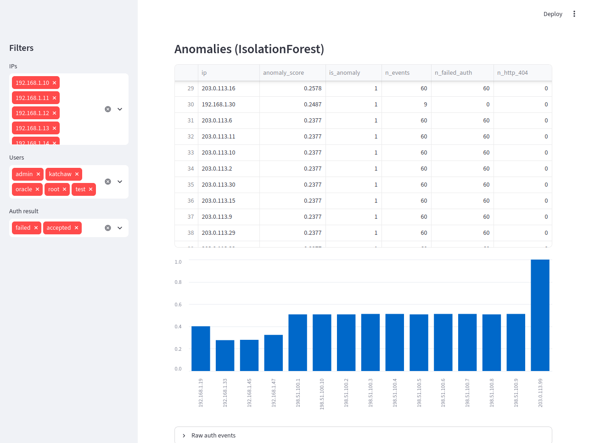

# Absolutus_V5

**Multi-source security log pipeline: SSH auth + nginx -> Python -> SQL -> R -> Streamlit.**

Parses failed logins and HTTP 404 scans, stores events in SQLite, runs
detection rules (brute-force, top attackers, off-hours, scan+brute
correlation), and exposes everything through an interactive dashboard.

**Stack:** Python, SQL, R, Streamlit, Cybersecurity
**Status:** v6.0.0 — IsolationForest anomaly detection over per-IP behavior.
**License:** MIT

## Quickstart

    pip install -e ".[dashboard]"
    absolutus parse            # parse logs -> CSV + SQLite
    absolutus detect top       # run a detection query
    absolutus detect correlation
    absolutus dashboard        # launch Streamlit UI

## CLI

    absolutus parse                 parse auth + nginx logs into SQLite
    absolutus detect <rule>         run a detection query
    absolutus report                parse + render R Markdown (needs R)
    absolutus dashboard             launch Streamlit UI
    absolutus --version

Rules available for `detect`:
    top           top 10 IPs by failed attempts
    bruteforce    >=5 failed logins per (ip, user)
    offhours      failures between 00:00-05:59
    correlation   IPs with >=5 SSH fails AND >=5 HTTP 404s

## What it does

1. Parse SSH auth log lines and nginx access lines (Python stdlib regex).
2. Store normalized events in SQLite (events, http_events).
3. Expose detection views (v_failed_by_ip, v_suspected_bruteforce, v_scan_and_bruteforce).
4. Render an R Markdown report (time-series + per-IP plots).
5. Serve an interactive Streamlit dashboard (filters, KPIs, correlation table).

## Sample output

    $ absolutus parse
    [+] 15 auth events, 10 http events -> data/

    $ absolutus detect top
    203.0.113.9|6|2026-10-30T08:15:11|2026-10-30T08:15:21
    198.51.100.7|5|2026-10-30T02:30:00|2026-10-30T09:02:48
    203.0.113.77|2|2026-10-30T14:00:00|2026-10-30T14:00:02

    $ absolutus detect correlation
    203.0.113.9|6|6

## Detection rules

    Rule          Logic                                   File
    ------------  --------------------------------------  ---------------------
    top           rank IPs by failed-attempt count        01_top_attackers.sql
    bruteforce    >=5 fails per (ip, user)                02_bruteforce.sql
    offhours      failures 00:00-05:59                    03_offhours.sql
    correlation   >=5 SSH fails + >=5 HTTP 404s per IP    04_scan_correlation.sql

## Project structure

    Absolutus_V5/
    |-- src/absolutus/
    |   |-- __init__.py       version
    |   |-- parsers.py        auth + nginx regex parsers
    |   |-- cli.py            argument parser and subcommands
    |   +-- dashboard.py      Streamlit app
    |-- python/pipeline.py    backward-compat shim
    |-- sql/
    |   |-- schema.sql        tables + indexes + views
    |   +-- queries/          detection queries
    |-- r/analysis.Rmd        R Markdown report
    |-- tests/test_pipeline.py  unit tests (unittest)
    |-- data/
    |   |-- sample_auth.log   tracked sample
    |   |-- sample_nginx.log  tracked sample
    |   |-- events.csv        gitignored
    |   +-- absolutus.db      gitignored
    |-- .github/workflows/ci.yml  CI: ruff + tests + CLI smoke
    |-- pyproject.toml
    |-- Makefile
    |-- CHANGELOG.md
    +-- LICENSE

## Development

    make install     # pip install -e .[dashboard]
    make test        # python unittest
    make lint        # ruff check
    make run         # absolutus parse
    make report      # absolutus report (needs R)
    make dashboard   # absolutus dashboard

CI (GitHub Actions) runs ruff, unit tests, CLI smoke test and a
dashboard import check on every push and pull request.

## Roadmap

- v1.x  core pipeline (auth -> SQLite -> queries)
- v2.x  multi-source (nginx + auth correlation)
- v3.x  CI (GitHub Actions, ruff)
- v4.x  installable CLI (absolutus ...)
- v5.x  interactive Streamlit dashboard      <- current
- v6.x  ML-based anomaly detection (IsolationForest)

## License

MIT

## Anomaly detection (v6)

Unsupervised scoring of every IP with IsolationForest, using per-IP
behavioral features:

    n_events, n_failed_auth, n_http_404, unique_users,
    rate_per_min, offhours_ratio, http_404_ratio

    absolutus anomalies --top 10

Output is also stored in `anomaly_scores` and surfaced in the dashboard
as an "Anomalies" table plus a bar chart of the top scores.

### Synthetic dataset

    python3 scripts/generate_synthetic.py
    absolutus parse --auth data/synthetic_auth.log --nginx data/synthetic_nginx.log

Generates ~2k auth + ~800 HTTP lines: benign traffic, 30 SSH
brute-force bursts, 10 HTTP scanners, and one "both" attacker.

The IsolationForest ranks the combined-attack IP first
(score=1.000, 120 events = 60 SSH + 60 HTTP). Single-source bursts
form the second tier (score ~0.51). This is the expected behavior
for unsupervised detection with `contamination="auto"`.
